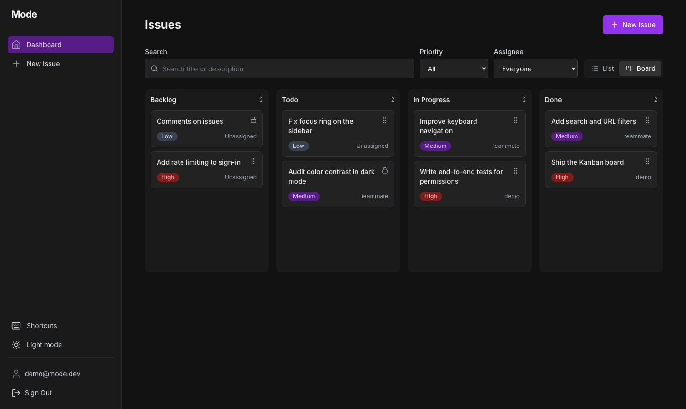
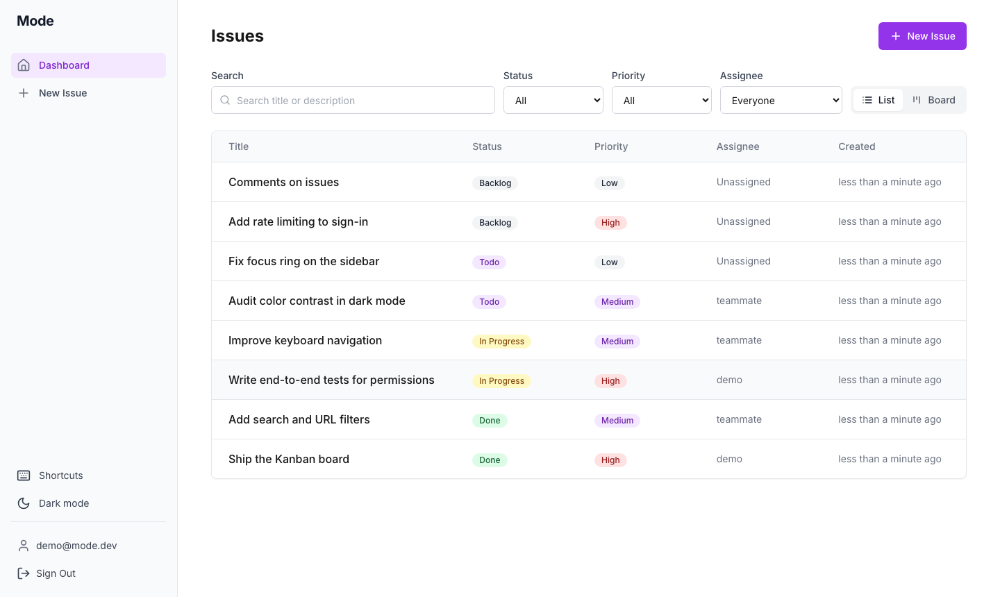

# Mode

An issue tracker with a drag-and-drop board, shareable filters and keyboard
shortcuts. Built with Next.js 16 Server Components, Server Actions and
PostgreSQL.

**[Live demo](https://next-js-fundamentals-alpha.vercel.app/)**: sign in with
`demo@mode.dev` and the password `mode-demo-2026`.





## Features

- **Kanban board:** drag issues between columns by mouse, touch or keyboard.
  Cards move instantly and return to their column if the server rejects the
  change.
- **Search and filters in the URL:** every view can be bookmarked or shared,
  and survives a reload.
- **Server-side pagination** that keeps the current filters.
- **Assignees** alongside a separate issue owner.
- **Permissions enforced on the server:** only the owner can edit or delete an
  issue. The assignee can also move it on the board.
- **Keyboard shortcuts:** `c` create, `/` search, `l` list, `b` board,
  `t` theme, `?` help.
- **Dark mode** that follows the system until you choose, with no flash on load.
- **Accessibility:** focus management, labelled controls, a skip link and live
  announcements for board moves.

## Tech stack

| Area | Choice |
| --- | --- |
| Framework | Next.js 16 (App Router, Cache Components), React 19 |
| Language | TypeScript |
| Database | PostgreSQL on Neon, Drizzle ORM |
| Auth | JWT in an `httpOnly` cookie (`jose`), passwords hashed with `bcrypt` |
| Styling | Tailwind CSS |
| Drag and drop | dnd-kit |
| Validation | Zod |
| Testing and CI | Playwright, GitHub Actions |

## How it's built

**Permissions live in the query, not just the UI.** Update and delete include
the owner in the `WHERE` clause, for example
`and(eq(issues.id, id), eq(issues.userId, user.id))`. If the row isn't yours,
nothing changes. The test suite proves this by capturing a real delete request
and replaying it with another user's session.

**Reads are cached and writes invalidate them.** `getIssues` uses `'use cache'`
with an `issues` tag, and every write calls `updateTag('issues')`, so the next
render is fresh without manual refetching.

**The URL is the state for filters.** The dashboard is a Server Component that
reads `searchParams`, validated by Zod so a hand-edited URL falls back to safe
defaults instead of failing.

**Optimistic updates use `useOptimistic`.** A failed move needs no rollback
code, because the board returns to the server's data when the transition ends.

**Serverless-friendly database access.** On Vercel the app uses Neon's HTTP
driver, so each function doesn't hold a connection open. Locally and in CI it
uses standard `node-postgres`.

**Secrets stay on the server.** The session contains only a user id, database
queries select explicit public columns, and a test asserts that password hashes
never appear in any page.

## Project structure

```
app/
  (marketing)/     Public pages
  (auth)/          Sign in and sign up
  dashboard/       List and board views
  issues/          Issue detail, create and edit
  actions/         Server Actions (all writes)
  api/             REST endpoints
  components/      UI, board, filters and shortcuts
lib/
  dal.ts           Data access layer (all reads and auth checks)
  auth.ts          Sessions and password hashing
  validation.ts    Shared Zod schemas
db/schema.ts       Drizzle schema
e2e/               Playwright tests
```

## Getting started

You need Node.js 22 or later and a PostgreSQL database. A free
[Neon](https://neon.tech/) database works well.

```bash
git clone https://github.com/Soheil86/mode.git
cd mode
npm install
cp .env.example .env
```

Set `DATABASE_URL` in `.env`, and set `JWT_SECRET` to the output of
`openssl rand -base64 32`. Then create the tables and start the app:

```bash
npm run db:push
npm run dev
```

Open [http://localhost:3000](http://localhost:3000).

To add demo data, run `npm run seed`. It creates `demo@mode.dev` and
`teammate@mode.dev` with the password `mode-demo-2026` (or `SEED_DEMO_PASSWORD`
if set), and never deletes existing data.

## Testing

The end-to-end tests create and delete data, so they need a throwaway database
and refuse to run against Neon:

```bash
npx playwright install chromium
DATABASE_URL=postgres://... npx drizzle-kit push --force
E2E_DATABASE_URL=postgres://... npm run test:e2e
```

GitHub Actions runs lint, the type check, the production build and the full
test suite on every push, using a temporary Postgres container.

## Known limitations

- Sign-in has no rate limiting yet.
- Board cards are ordered by creation date, not by manual position.
- Everyone who signs up shares one workspace. There are no teams yet.
